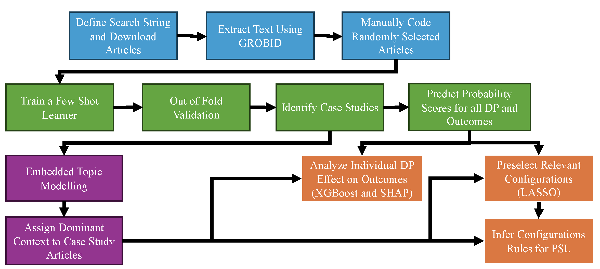

# Synthesis of Ostrom Institutional Design Principles

This repository contains the data used (list of doi of articles and manually coded papers) and the python scripts used for the analysis of institutional design principles. The scripts contained here should be used in order.

#Data
The DataFinal.xlsx file contains the list of dot for the articles downloaded for the analysis and the manually coded articles (with codes and annotations).

## Workflow:

 

## Scripts:

1. CSP_1_GetArticles.py

Downloads and organizes the scientific articles used in the analysis pipeline. This is the entry point for reproducing the study Blueprints for Success: Leveraging Natural Language Processing to Assess the Effect of Ostrom Institutional Design Principles on Resources, Conflict, and Inequality in the Commons.

2. CSP_2_PdfToCleanText.py

Converts PDF files into machine-readable text using GROBID, PyMuPDF, and Tesseract OCR. The script extracts article structure, identifies relevant sections, removes non-substantive content (e.g., references and acknowledgements), and produces the text corpora used in downstream analyses.

3. CSP_3_Newton_FewShotLearner_AnnVF.py

Trains and evaluates few-shot learning models for:

* case-study identification,
* institutional design principle (DP) coding,
* outcome coding (resource conditions, conflict, and inequality).

The script uses SciCo/Longformer embeddings, SetFit, Optuna-based hyperparameter optimization, and nested cross-validation. Outputs include hard classifications, class probabilities, and uncertainty-aware probability scores.

4. CSP_4_EmbeddedTopics.py

Applies Embedded Topic Modeling (ETM) to texts classified as single-case studies. The script identifies dominant social-ecological contexts, estimates topic distributions, and produces the contextual variables used in subsequent analyses.

5. CSP_5_XGBoost_Shapley_VF.py

Analyzes relationships between institutional design principles and outcomes using XGBoost and SHAP. The script:

* evaluates alternative uncertainty thresholds,
* estimates aggregate and context-specific models,
* calculates SHAP values and SHAP interaction values,
* produces individual DP importance and effect figures.

6. CSP_6_PSL_ModelBuilder.py

Contains the functions required for the PSL analysis. The module:

* constructs Probabilistic Soft Logic (PSL) models,
* generates and evaluates candidate configurations,
* calculates configuration coverage, consistency, effect, and importance,
* builds co-occurrence networks,
* performs network and community analyses.

Candidate configurations are pre-screened using repeated LASSO interaction models.

7. CSP_7_PSL_Analysis.py

Evaluates institutional configurations using Probabilistic Soft Logic (PSL). The script:

* learns PSL rule weights,
* ranks and filters competing configurations,
* performs sensitivity analyses,
* constructs DP co-occurrence networks,
* identifies communities using the Leiden algorithm,
* generates the configurational and network figures reported in the paper.
